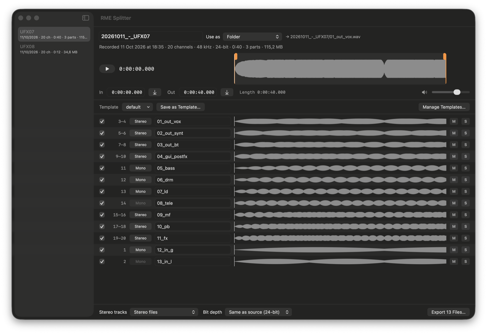

# RME Splitter

Splits multichannel WAV recordings from RME interfaces (DURec on a UFX and similar) into separate, named mono and stereo tracks.

There are two versions in this repository:

- **`app/`**: a native macOS app with drag and drop, waveforms, audio preview, trimming and editable naming templates. It has no dependencies.
- **`cli/`**: the original `rme-split` shell script, which does the same split from the terminal using ffmpeg.

Both produce the same audio: the app's test suite runs the CLI on a sample recording and checks the output is byte-identical.



## The app

### Requirements

- macOS 15 or later
- Xcode or the Xcode command line tools, to build it

### Build and run

```sh
cd app
./build.sh
open "build/RME Splitter.app"
```

The build is signed ad hoc for the machine it was built on. There is no notarised download, so build it on the Mac you intend to use it on.

To run the tests:

```sh
cd app
swift test
```

### Opening recordings

Drop a folder, an SD card volume or a WAV file on the window or the Dock icon, or use File > Open (⌘O).

- Recorders split long takes at the FAT32 file size limit (`UFX04_00.WAV`, `UFX04_01.WAV`, …). The parts are joined and shown as one recording. Dropping a single part pulls in the rest of its take.
- A folder with several takes lists them in a sidebar with date, channel count, duration, parts and size.
- The app reopens the last folder at launch if it is still available.

Supported files are WAV, RF64 and BW64 with 16, 24 or 32-bit integer or 32-bit float samples, at any channel count and sample rate.

Files that don't follow the recorder naming pattern (letters, a take number, an underscore and a two-digit part number) are only joined when the earlier part is at least 1 GB, so `song_1.wav` and `song_2.wav` stay separate takes.

### Tracks

Each row is one output track.

| Control | What it does |
| --- | --- |
| Checkbox | Includes the track in the export |
| Channel number | Source channel or pair, counted from 1 |
| Mono / Stereo | Click **Mono** to pair the track with the one below; click **Stereo** to split it |
| Name | The output file name, without `.wav` |
| Waveform | Click or drag to solo that track and play from that point |
| M / S | Mute and solo for the preview; they don't affect the export |

Waveforms are a quick sampled overview so that multi-gigabyte takes on an SD card appear in seconds. Very short transients may not show.

### Templates

A template is a saved list of tracks: which channels, paired or not, and what each is called.

- Choose one from the **Template** menu to apply it. Channels the template doesn't mention are listed at the bottom, unticked.
- **Save as Template…** stores the ticked tracks of the current layout. **Update** appears when the layout has changed from the applied template.
- **Manage Templates…** (⌘T) edits, duplicates and deletes templates, and imports or exports the CLI's `.conf` format.
- The template last used for a given channel count is applied automatically to the next recording with that many channels.

Templates are stored in `~/Library/Application Support/RME Splitter/templates.json`. On first launch that file is seeded from the `.conf` files in `app/Resources/Templates`; replace those with your own layouts before building if you want different defaults.

### Preview and trim

| Key | Action |
| --- | --- |
| Space | Play or pause |
| I | Set the start (In) to the playhead |
| O | Set the end (Out) to the playhead |

- Click or drag in the top waveform to move the playhead; it lines up with the track waveforms below.
- Drag the orange handles, or type times into **In** and **Out** (`ss`, `mm:ss` or `h:mm:ss.mmm`), to trim. The trim applies to every exported track.
- Playback stays inside the trim range.

### Naming and export

The field at the top is the recording's name. It defaults to `yyyymmdd_-_name`, with the date taken from the first file's timestamps, and can be edited. **Use as** decides what the name does:

| Option | Result |
| --- | --- |
| Folder | `20261011_-_UFX07/01_vox.wav` |
| File prefix | `20261011_-_UFX07_01_vox.wav` |
| Folder and file prefix | `20261011_-_UFX07/20261011_-_UFX07_01_vox.wav` |
| Not used | `01_vox.wav` |

Export options, at the bottom of the window:

- **Stereo tracks**: one stereo file per pair, or separate `_L` and `_R` mono files.
- **Bit depth**: same as the source (samples are copied bit for bit), or converted to 16-bit (with dither), 24-bit or 32-bit float.

Export (⌘E) asks for a destination folder, warns before replacing existing files, and never overwrites the source recording. Files over 4 GB are written as RF64.

### Project layout

```
app/
  Sources/SplitterCore/   WAV reading and writing, multi-part joining, templates, export
  Sources/RMESplitter/    SwiftUI interface and audio preview
  Tests/                  unit tests, including the comparison against the CLI
  Resources/Templates/    .conf layouts bundled as starter templates
  Resources/AppIcon.icns  app icon, drawn by Scripts/make-icon.swift
  build.sh                builds build/RME Splitter.app
```

## The CLI

`cli/rme-split` needs `ffmpeg` and `ffprobe`. It uses `cli/bin/ffmpeg` and `cli/bin/ffprobe` if you put binaries there, and otherwise whatever is on your `PATH` (`brew install ffmpeg`).

```sh
# Split a recording; all parts are found from the first file
cli/rme-split split "/Volumes/RME/UFX04_00.WAV" ./REC04

# List the recordings on a volume
cli/rme-split scan /Volumes/RME

# Split every recording on a volume
cli/rme-split batch /Volumes/RME ./output

# Use the layout in rme-split-ufx.conf
cli/rme-split --config ufx split "/Volumes/RME/UFX08_00.WAV" ./output
```

A layout file has one track per line: the channel or channel pair, counted from 0, then the output name.

```
2-3     01_vox
10      05_bass
```

Note that the CLI and its `.conf` files count channels from 0, while the app shows them from 1. The app converts when importing and exporting `.conf` files.

Fuller CLI documentation is in [`cli/docs/index.html`](cli/docs/index.html).
